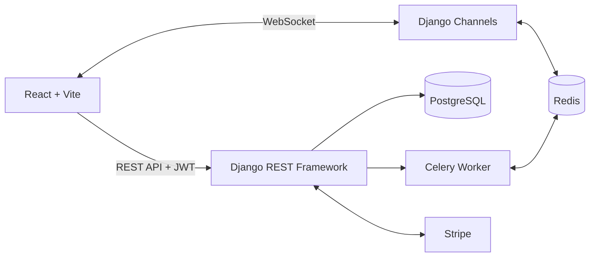

# CRM Flow

A full-stack **Customer Relationship Management (CRM)** application for managing leads, organizing teams, and communicating in real time—all from one dashboard.

Built with **Django REST Framework, React, and PostgreSQL**, CRM Flow features role-based access control, real-time messaging, notifications, and subscription-based feature access.

[Report a Bug](https://github.com/pragyaa-19/crm/issues)

---

## Features

### Authentication & Access Control

- User registration and login with JWT authentication.
- Role-based access for Owners, Managers, and Employees.
- Protected frontend routes and authenticated API endpoints.

### Lead Management

- Create, view, edit, and assign leads to employees.
- Track lead statuses: New, Called, Interested, Lost, and Won.
- Soft-delete leads, restore them, or permanently delete them from the trash.
- Paginated lead listings.

### Team Management

- Invite users by email and assign roles during invitation.
- Accept invitations to join a company.
- Enforce role-based restrictions on team operations.

### Real-Time Messaging

- Direct and group conversations.
- Real-time messaging powered by WebSockets and Django Channels.

### Notifications

- Real-time notification delivery over WebSockets.
- REST API endpoints for notification history and unread counts.

### Subscription Management

- Free and paid subscription plans.
- Stripe Checkout integration.
- Plan-based feature access, including a Reports section for paid users.

---

## Screenshots

Screenshots coming soon.

\<!-- Add screenshots here once available.
Example:

![Dashboard]\(docs/screenshots/dashboard.png)
![Lead Management]\(docs/screenshots/leads.png)
![Real-Time Messaging]\(docs/screenshots/messaging.png)
\-->

---

## Roles & Permissions

| Capability                          | Owner | Manager | Employee |
| ----------------------------------- | :---: | :-----: | :------: |
| Manage company and subscription     |  Yes  |    No   |    No    |
| Invite and manage team members      |  Yes  |   Yes   |    No    |
| Create and assign leads             |  Yes  |   Yes   |    No    |
| Update the status of assigned leads |  Yes  |   Yes   |    Yes   |
| Access messaging and notifications  |  Yes  |   Yes   |    Yes   |

## Subscription Plans

| Feature                     | Free | Paid |
| --------------------------- | :--: | :--: |
| Lead and team management    |  Yes |  Yes |
| Messaging and notifications |  Yes |  Yes |
| Reports                     |  No  |  Yes |

---

## Tech Stack

| Layer                     | Technologies                                                               |
| ------------------------- | -------------------------------------------------------------------------- |
| Frontend                  | React, Vite, React Router, Tailwind CSS, Axios, Lucide React               |
| Backend                   | Python, Django, Django REST Framework, Simple JWT, Django Channels, Celery |
| Database & Infrastructure | PostgreSQL, Redis, Docker                                                  |
| Payments                  | Stripe                                                                     |

---

## Architecture



### How It Works

1. **Frontend:** React provides the user interface and communicates with the backend.
2. **REST API:** Django REST Framework handles authenticated API requests using JWT.
3. **Database:** PostgreSQL stores application data.
4. **Real-Time Communication:** Django Channels handles WebSocket connections for messaging and notifications, with Redis used as the channel layer when configured.
5. **Background Tasks:** Celery processes asynchronous tasks using Redis as its broker.
6. **Payments:** Stripe Checkout handles subscription payments.

---

## Project Structure

```text
crm/
├── frontend/
│   ├── src/
│   │   ├── components/
│   │   ├── pages/
│   │   ├── routes/
│   │   └── utils/
│   └── package.json
│
└── backend/
    ├── manage.py
    ├── project/
    ├── users/
    ├── leads/
    ├── teams/
    ├── notifications/
    ├── messanger/
    └── subscriptions/
```

*This is a representative structure. Update the directory names to match your actual repository.*

---

## Getting Started

Follow these steps to run CRM Flow locally.

### Prerequisites

Make sure you have the following installed:

- Python 3.10+
- Node.js 18+ and npm
- PostgreSQL
- Redis
- Git

Docker is optional if you prefer a containerized setup.

### 1. Clone the Repository

```bash
git clone https://github.com/pragyaa-19/crm.git
cd crm
```

### 2. Set Up the Backend

Navigate to the backend directory:

```bash
cd backend
```

Create and activate a virtual environment.

**Linux / macOS**

```bash
python3 -m venv myenv
source myenv/bin/activate
```

**Windows**

```bash
python -m venv myenv
myenv\Scripts\activate
```

Install the dependencies:

```bash
pip install -r requirements.txt
```

### 3. Configure Environment Variables

Create your local environment file:

```bash
cp .env.example .env
```

Configure the required variables in `.env`:

| Variable            | Description                                              |
| ------------------- | -------------------------------------------------------- |
| `SECRET_KEY`        | Django secret key                                        |
| `DEBUG`             | Enable debug mode for local development                  |
| `DATABASE_NAME`     | PostgreSQL database name                                 |
| `DATABASE_USER`     | PostgreSQL username                                      |
| `DATABASE_PASSWORD` | PostgreSQL password                                      |
| `DATABASE_HOST`     | Database host, such as `localhost`                       |
| `DATABASE_PORT`     | PostgreSQL port, usually `5432`                          |
| `REDIS_URL`         | Redis connection URL, such as `redis://localhost:6379/0` |
| `STRIPE_SECRET_KEY` | Stripe secret key; use test mode for local development   |

**Note:** These variable names are examples. Make sure they match the configuration used by your backend. Create `.env.example` if it does not already exist, and never commit your actual `.env` file or secret keys.

### 4. Set Up the Database

Create the PostgreSQL database:

```sql
CREATE DATABASE crm_db;
```

Ensure your database credentials match your environment configuration.

Run migrations:

```bash
python manage.py migrate
```

Optionally, create an administrator account:

```bash
python manage.py createsuperuser
```

Start the Django development server:

```bash
python manage.py runserver
```

The backend will be available at:

`http://127.0.0.1:8000/`

### 5. Start the Background Worker

If your project uses Celery with Redis, make sure Redis is running first.

In a separate terminal, activate the backend virtual environment and run:

```bash
celery -A project worker --loglevel=info
```

Replace `project` with the actual Python package containing your Celery application.

### 6. Set Up the Frontend

Open a new terminal and navigate to the frontend directory from the repository root:

```bash
cd frontend
```

Install dependencies:

```bash
npm install
```

If your frontend uses environment variables, create the local configuration file:

```bash
cp .env.example .env
```

Set the API base URL to your local backend, using the variable name expected by your application. For example:

```env
VITE_API_BASE_URL=http://127.0.0.1:8000
```

Start the development server:

```bash
npm run dev
```

Open the local URL displayed in your terminal, usually:

`http://localhost:5173/`

### Running with Docker

If your repository includes a configured `compose.yaml` or `docker-compose.yml`, start the services with:

```bash
docker compose up --build
```

This command only works when the required Docker Compose configuration is present and correctly configured.

---

## Authentication

Protected API requests use a JWT access token in the `Authorization` header.

```http
Authorization: Bearer <access_token>
```

The backend validates authentication and permissions before allowing access to protected resources.

---

## API Overview

The following table lists key API endpoints used by the application.

| Module         | Endpoint                           | Purpose                            |
| -------------- | ---------------------------------- | ---------------------------------- |
| Authentication | `/api/login/`                      | Authenticate a user                |
| Users          | `/api/me/`                         | Retrieve current user information  |
| Invitations    | `/invitations/api/invite/`         | Invite team members                |
| Notifications  | `/notifications/api/`              | Retrieve notifications             |
| Notifications  | `/notifications/api/unread-count/` | Retrieve unread notification count |
| Subscriptions  | `/subscriptions/my-subscription/`  | Retrieve subscription details      |
| Subscriptions  | `/subscriptions/checkout/`         | Initiate Stripe Checkout           |

*Confirm the exact routes in your Django URL configuration before publishing this documentation.*

---

## Testing

Run the Django test suite from the backend directory:

```bash
python manage.py test
```

You can also use Postman to test REST API endpoints.

Recommended testing areas include:

- JWT authentication and authorization.
- Role-based permissions.
- Lead creation, assignment, and deletion.
- Invitation workflows.
- Pagination and data filtering.
- Notifications and unread counts.
- WebSocket connections.
- Subscription checkout and plan-based access.

---

## Security

CRM Flow follows important security practices:

- Sensitive credentials should be stored in environment variables.
- Company-level data isolation and role checks should be enforced by the backend.
- Subscription-gated features should be validated server-side.
- Protected API endpoints should verify authentication and permissions.
- Production deployments should use `DEBUG=False`, appropriate `ALLOWED_HOSTS` and CORS settings, and HTTPS.

---

## What I Learned

Building CRM Flow helped me explore:

- Designing REST APIs with Django REST Framework.
- Implementing JWT authentication and role-based permissions.
- Managing company-level data isolation in a multi-tenant application.
- Building real-time communication features using Django Channels and WebSockets.
- Working with Redis and asynchronous tasks using Celery.
- Integrating Stripe Checkout and subscription-based feature access.
- Connecting a React frontend to a Django backend.

---

## Roadmap

- [ ] Advanced lead search and filtering.
- [ ] Enhanced reports and analytics.
- [ ] Improved subscription lifecycle management.
- [ ] Expanded automated test coverage.
- [ ] API documentation with OpenAPI/Swagger.
- [ ] CI/CD and production deployment.

---

## Author

**Pragya Rathore**

- GitHub: [@pragyaa-19](https://github.com/pragyaa-19)
- Issues and bug reports: [GitHub Issues](https://github.com/pragyaa-19/crm/issues)

---

## License

This project is intended for portfolio and learning purposes.

If you choose to release it under the MIT License, add a `LICENSE` file containing the MIT License text. Otherwise, update this section to reflect the license you actually use.
